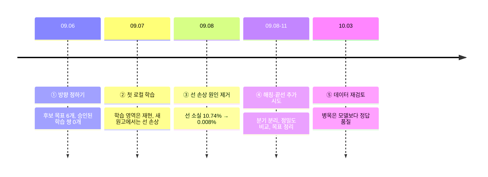

# Ink Transfer Net

**선의 위치는 그대로 두고 잉크 표현(굵기·농도·끝선·해칭)만 바꾸는 결정론적 선화 변환 모델 연구**

| | |
|---|---|
| 과제 | 웹툰 제작사 산학협력 과제의 후속 연구 (연구실 수행, 1인 담당). 관련 저장소: [webtoon-style-lora](https://github.com/guswns578/webtoon-style-lora) |
| 기간 | 2026.08 ~ 2026.10 (진행 중) |
| 현재 상태 | **선 보존 기반 모델은 확보, 해칭·끝선 같은 화풍 전이는 아직 목표 미달.** 병목을 데이터로 좁혀 데이터 재구성 단계 |
| 핵심 기술 | PyTorch, 픽셀 공간 잔차 네트워크, signed distance field, 타일 추론 |
| 환경 | RTX 5070 12GB |
| 테스트 | 단위 테스트 4개 통과 (빈 입력 유지, 원본 크기 유지, identity 초기화, 잉크 추가·제거 경로) |

> 원작 선화, 학습 목표 이미지, 체크포인트, 결과 이미지는 저작권 문제로 공개하지 않습니다.

---

## 왜 시작했나

[웹툰 스타일 LoRA 연구](https://github.com/guswns578/webtoon-style-lora)에서 다른 작품의 선화를 원작 화풍으로 바꾸려고 스타일 LoRA를 img2img로 적용했더니 문제가 있었습니다.

- denoise가 낮으면 선 표현이 거의 바뀌지 않습니다.
- denoise를 높이면 선 굵기뿐 아니라 **얼굴, 체형, 의상 구조까지 바뀝니다.**
- ControlNet이나 골격 조건은 복잡한 옷 주름, 머리카락, 교차선, 해칭을 지키지 못합니다.

필요한 것은 새 그림을 생성하는 모델이 아니라, **원래 선의 위치와 연결은 그대로 두고 잉크 표현만 원작처럼 바꾸는 모델**이었습니다. 그래서 디퓨전이 아닌 결정론적 픽셀 공간 모델을 따로 설계했습니다.

| 목표 | 비목표 |
|---|---|
| 입력과 출력의 크기가 정확히 같음 | 얼굴이나 인체를 새로 생성 |
| 같은 입력이면 항상 같은 출력 | 원본에 없는 큰 주름·윤곽을 자유롭게 추가 |
| 선 위치, 연결, 얼굴·의상 구조 보존 | 텍스트 프롬프트 기반 생성 |
| 선 굵기, 농도, 끝선 taper, 해칭 간격을 원작처럼 | 디퓨전 모델 내장 |

설계 초안: 다중 임계 거리장(SDF)·방향장·검은 면 마스크를 입력으로 받아, 거리장 보정량·농도·가장자리 부드러움·보존 게이트를 예측하고 미분 가능한 잉크 렌더러로 다시 그리는 구조입니다. 설계안을 외부 검토에 부쳐 "실패할 지점"을 먼저 찾았습니다 ([설계 문서](docs/design.md)).

## 가장 큰 제약: 정답 쌍이 없다

"다른 작품의 선화"와 "그것을 원작 작가가 다시 그린 정답"이 짝지어진 데이터가 거의 없었습니다. 그래서 이미지 편집 모델로 원하는 방향의 **후보 목표**를 만들고, 이를 시각적 방향으로만 승인받아 학습했습니다. 이 후보는 작가가 인증한 정답이 아니며, 모든 결과에서 **원본 / 후보 목표 / 실제 모델 출력**을 구분해 기록했습니다.

## 연구 흐름



### ① 방향 정하기: 승인된 학습 쌍 0개에서 시작

다른 작품의 원고 24개 영역과 원작 참고 선화 12개 영역을 골라, 이미지 편집 모델로 "선 표현만 바꾼 후보"와 "작은 해칭까지 허용한 후보"를 만들었습니다. 얼굴 후보는 형태를 잘 따랐지만 화풍 변화가 약했고, 옷·눈 후보는 선 위치가 7~8px 어긋났습니다. 이 단계에서 승인된 학습 쌍은 0개라고 명시했습니다.

### ② 첫 로컬 학습: 재현은 되지만 일반화는 안 된다

약 54만 파라미터의 작은 잔차 네트워크를 처음부터 학습했습니다(얼굴 2쌍, 1,600 step, 약 67초).

| 원본 대비 잉크 주변 오차 감소 | 학습 모델 | 단순 흐림·농도 보정 |
|---|---:|---:|
| 학습 이미지 1 | 10.77% | 6.63% |
| 학습 이미지 2 | 16.86% | 9.54% |
| 학습하지 않은 페이지 | 7.08% | 5.37% |

하지만 새 이미지에서는 선이 자글거리고 가는 선이 사라졌습니다. 그래서 **네트워크가 목표를 표현할 능력 자체가 없는지**를 따로 확인했습니다. 작은 영역 4개만 집중 학습하자 오차가 88~96% 줄었고, 머리끝 잔선과 목 해칭도 재현됐습니다. 결론: 표현 능력은 있지만, 그 학습이 다른 원고로 일반화되지 않았습니다.

### ③ 선 손상 원인 제거: 구조를 바꿔 선 소실을 없앰

선 손상의 원인으로 해상도를 줄였다 키우는 연산을 의심했습니다. 다운샘플·PixelShuffle·전역 pooling·정규화를 모두 없앤 **원본 해상도 전용 구조**(stride 1, 수용 영역 53px, 약 50만 파라미터)를 만들고, 같은 데이터·학습량에서 비교했습니다.

| 모델 | 선 소실 대리지표 평균 (미학습 17개 크롭) | 최댓값 |
|---|---:|---:|
| A. 기존 구조 | 10.74% | 37.92% |
| B. 원본 해상도 구조 | 1.18% | 5.83% |
| C. B + 선 보존 손실 | **0.008%** | 0.031% |

- 선 보존 손실은 결과를 흐리거나 원본을 합성하는 후처리가 아니라 **학습 손실**입니다.
- 입력을 1px 옮긴 결과를 되돌려 비교하면 B·C는 오차 0, 패치 단위 추론과 전체 이미지 추론도 오차 0이었습니다.
- 대가도 기록했습니다. 원본을 강하게 지킬수록 **화풍 변화가 약해졌습니다**(후보 목표 쪽 오차 감소 7.08% → 3.68%). 이 지표는 원본에 가까울수록 좋아지므로 단독으로 성공을 주장할 수 없습니다.

이 C 모델을 안전한 기반 모델로 고정했습니다.

### ④ 해칭·끝선 추가 시도: 원인을 하나씩 좁힘

| 시도 | 결과 | 판단 |
|---|---|---|
| 기반 모델 미세조정 | 학습 영역에서도 해칭이 거의 안 나옴 | 학습 시간만 늘리는 것은 다음 주력이 아님 |
| 기반 모델 고정 + 별도 디테일 분기 (수용 영역 77px) | 학습 영역 오차 26~37% 감소, 하지만 가는 해칭 대신 회색 번짐·겹선, 미학습 선 소실 1.78% | 오차 감소를 화풍 습득으로 해석하지 않음 |
| 한 영역만 학습, BF16 vs FP32 | 두 정밀도 결과가 거의 같음 (MAE 0.0190 vs 0.0193) | 계산 정밀도는 원인이 아님 |
| 기울기 손실 제거 | 학습 영역 오차 악화 (0.0190 → 0.0227) | 손실 유지 |
| **학습 목표 정리** (후보 목표 중 원하는 끝선 부분만 쓰고, 나머지는 기반 모델 출력을 목표로) | 유지해야 할 영역의 불필요한 변화 **86% 감소**, 미학습 선 소실 1.3~3.7% → 0.6~2.2%. 단, 작은 잔선 수 등 일부 지표는 나빠짐 | 가장 큰 개선. 원하는 수정과 원하지 않는 수정이 섞인 **목표 자체가 문제**라는 근거 |

이후 여러 영역 학습, 패치 판별기, 음성 예제 가드를 비교했지만 채택 기준(원본 크기, 정체성·포즈·윤곽 보존, 자연스러운 해칭과 끝선)을 통과한 모델은 아직 없습니다.

### ⑤ 데이터 재검토: 네트워크보다 정답이 먼저

작가가 실제로 리터치한 원고와 원래 생성 이미지를 자동으로 짝지은 후보 169쌍을 감사했습니다 ([데이터 감사](docs/data_audit.md)).

- 167쌍에서 정답 쪽 검은 픽셀이 더 많았는데, 선 굵기 변화가 아니라 배경·먹칠·재작화·정렬 차이가 섞인 결과였습니다.
- 한 쌍 안에 "선 정돈"과 "의상 구조 재작화"가 함께 들어 있어, 그대로 학습하면 모델이 구조까지 바꾸도록 배우게 됩니다.
- 자동 매칭은 대응 후보 탐색일 뿐, 실제로 리터치에 쓰인 버전을 증명하지 않습니다.

결론: **169쌍을 그대로 학습하지 않고**, 원본 작업 파일에서 리터치 전후 선화 레이어를 같은 캔버스로 확보한 뒤, 영역 단위로 "선·농도 정돈만" 감독하는 방향으로 다음 단계를 설계했습니다.

## 실험에서 바꾼 판단

| 상황 | 바꾼 판단 |
|---|---|
| 학습 영역의 오차가 크게 줄었음 | 오차 감소 ≠ 화풍 습득. 미학습 원고를 원본 해상도에서 직접 확인 |
| 작은 영역 암기에 성공 | 표현 능력 확인과 일반화 성능을 분리해서 보고 |
| 선 보존 지표가 크게 좋아짐 | 원본을 그대로 돌려줘도 좋아지는 지표라 단독 성공 기준이 아님 |
| BF16 정밀도를 의심 | 같은 조건에서 FP32와 비교해 기각 |
| 모델 구조·학습량을 계속 바꿔 봄 | 목표를 정리한 실험이 가장 큰 효과 → 데이터 품질을 우선 |
| 이미지 편집 모델의 후보를 목표로 사용 | 작가 인증 정답이 아님을 모든 결과에 명시, 원본/후보/출력을 항상 분리 표기 |

## 저장소 구조

```
oit/
  model.py               첫 잔차 네트워크와 잉크 합성
  fullres_model.py       원본 해상도 전용 구조 (③의 기반 모델)
  detail_branch.py       기반 모델을 고정한 디테일 분기 (④)
  prepare.py             잉크 알파·거리 채널 등 입력 특징
  train.py, train_fullres.py, train_detail.py, run_detail_branch.py
  memorize.py            작은 영역 표현 능력 검사
  single_detail_audit.py 한 영역 재현과 정밀도 비교
  curated_multi.py       정리한 목표로 여러 영역 학습
  train_patch_critic.py  패치 판별기 비교 (학습 전용)
  infer_fullres.py, fresh_panels.py   타일 추론 (입력만 사용, 목표·마스크 불필요)
  eval_integrity.py, evaluate.py      선 소실 대리지표, 이동 불변성 검사
  verify_fullres.py, check_detail_pipeline.py   크기 유지·타일 일치 검사
  test_pilot.py          단위 테스트
docs/
  design.md              초기 설계안과 외부 검토 요청 내용
  data_audit.md          리터치 전후 대응 데이터 감사
```

> 포트폴리오 공개를 위해 포맷(black)과 쓰지 않는 import만 정리했고 로직은 바꾸지 않았습니다. 정리 전 코드는 [`original-snapshot`](https://github.com/guswns578/ink-transfer-net/tree/original-snapshot) 태그에 있습니다.

## 역할

산학협력 과제의 후속 연구로 문제 정의, 모델 설계, 학습·진단 실험, 데이터 감사까지 혼자 수행했습니다. 구현에는 AI 코딩 도구를 적극 활용했고, 실험 설계·판단 기준·결과 해석은 직접 수립했습니다.
